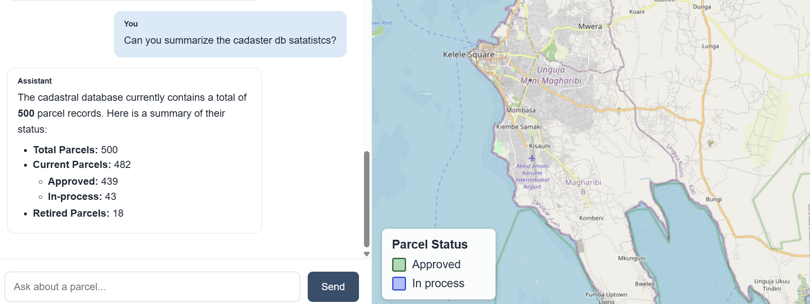
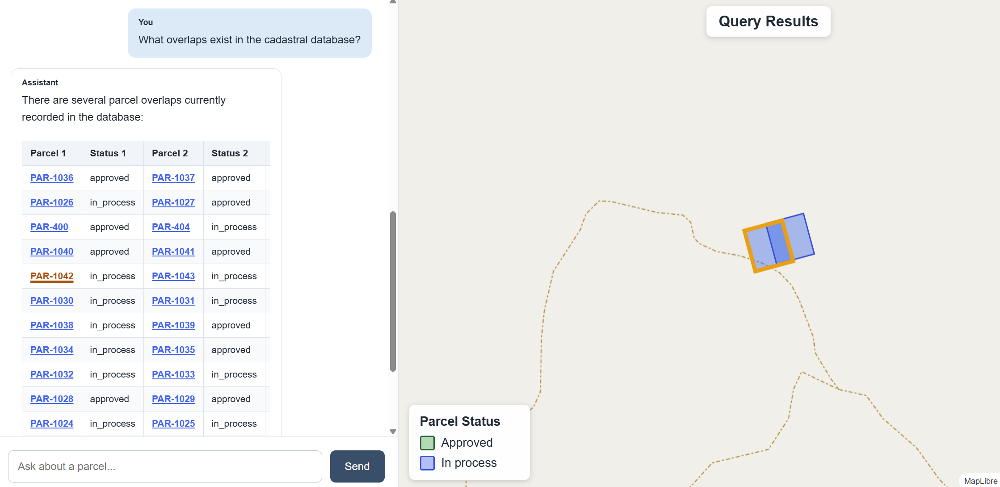
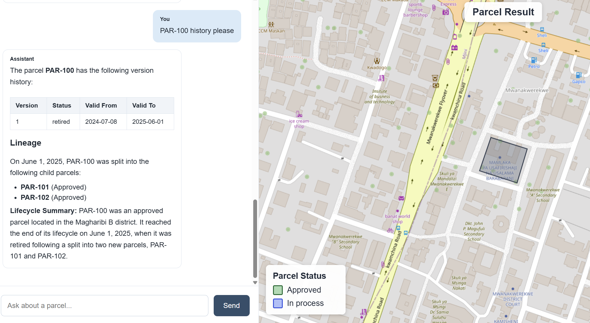

# Cadaster AI Assistant

Ask a cadastral database a question in plain language, such as *"What overlaps exist?"* or *"Show me
the history of parcel PAR-101"*, and get an answer grounded in curated data, with the parcels drawn
on a map. **The AI never gets free access to the database.** It can only call a small set of
predefined tools, and each tool reads a curated dbt model.

**[Live demo](https://cadaster-ai-frontend.netlify.app/)** · proof of concept, 2026



## The problem

Users of cadastral and land-information systems usually inspect the data through predefined forms,
filters, reports and GIS layers. To get an answer they need to know which table holds it, which
layer to open, which filter to apply and how the data model fits together. They often know the
business question ("which parcels overlap?", "what happened to this parcel?") but not how to
translate it into the system's menus.

This proof of concept explores closing that gap **without handing an LLM unrestricted SQL access**.

## How it works

```
User question
   → LLM agent           interprets intent, picks a tool (never writes SQL)
   → approved tool       deterministic, parameterised call
   → dbt model / view    curated, controlled
   → PostGIS
   → answer + GeoJSON    narrated by the agent, drawn on the map
```

- **The agent** is a LangChain `create_agent` over Google Gemini (`temperature=0`), with
  in-memory conversation history (LangGraph checkpointer). Its system prompt requires it to answer
  only from tool output and to say when information is missing.
- **The tools** (`backend/tools/parcel_tools.py`) are the agent's whole interface to the data:

  | Tool | Answers |
  |---|---|
  | `get_current_parcel` | The current version of a parcel |
  | `get_parcel_history_tool` | All versions of a parcel, plus its lineage (splits, retirements, successors) |
  | `get_parcels_by_area` | Parcels in a district, filtered by status |
  | `get_parcel_overlaps_tool` | Overlapping parcel pairs, optionally by area |
  | `get_parcel_statistics_tool` | Counts of current, approved, in-process and retired parcels |

- **dbt** turns the raw `districts` and `parcels` tables into staging views and five marts:
  current parcels, parcel history, parcel lineage, parcel overlaps and a district summary. The
  tools query only these marts.
- **The frontend** (React + MapLibre GL) shows the chat next to a map. Spatial results come back
  from the API as GeoJSON and are drawn on it.

| Overlaps | Parcel history and lineage |
|---|---|
|  |  |

## Try it

In the [live demo](https://cadaster-ai-frontend.netlify.app/), try:

- *Can you show me the current approved parcels in District Mjini?*
- *What overlaps exist in the cadastral database?*
- *Can you show me the history of parcel PAR-101?*
- *Summarise the cadaster database statistics.*

## Running locally

Requires Python, Node.js, Docker and a Google AI Studio API key.

```bash
# 1. Database: PostGIS on localhost:5433. Load your raw.districts and raw.parcels tables.
docker compose up -d

# 2. Curated models
cd dbt/cadaster_dbt && dbt run && cd ../..

# 3. Backend
cp .env.example .env                # set DATABASE_URL and GOOGLE_API_KEY
pip install -r backend/requirements.txt
uvicorn backend.api.main:app --reload
pytest backend/tests

# 4. Frontend
cd frontend
echo "VITE_API_BASE_URL=http://localhost:8000" > .env.local
npm install && npm run dev          # http://localhost:5173
```

The demo database is not included in the repository. The hosted demo runs on Aiven PostgreSQL,
and a scheduled GitHub Action keeps it awake.

## Repository layout

```
backend/
  agent/      agent factory, assistant wrapper, system prompt
  tools/      the five LLM-callable tools
  database/   connection and repository (parameterised SQL over dbt marts)
  api/        FastAPI app: /chat, /parcels/current/geojson, /health
  llm/        model configuration (Gemini)
  tests/      unit tests for tools, repository and agent
dbt/cadaster_dbt/
  models/staging/  stg_districts, stg_parcels
  models/marts/    current parcels, history, lineage, overlaps, district summary
frontend/     React + Vite chat UI with a MapLibre map panel
```

## Scope

This is a proof of concept, not a production cadastral system. The point is the architecture:
natural-language access in which every database operation is fixed in advance, auditable and
deterministic. Adding a new kind of question means adding a dbt model and a tool, not widening
what the LLM may do.

## Tech stack

Python · FastAPI · LangChain / LangGraph · Google Gemini · dbt · PostgreSQL / PostGIS · React ·
Vite · MapLibre GL · Docker · Netlify / Aiven

Licence: [MIT](LICENSE). Author: **Ofer Shahal**, [portfolio](https://ofer-geo.github.io/personal_portfolio/projects/cadaster-ai-assistant/)
